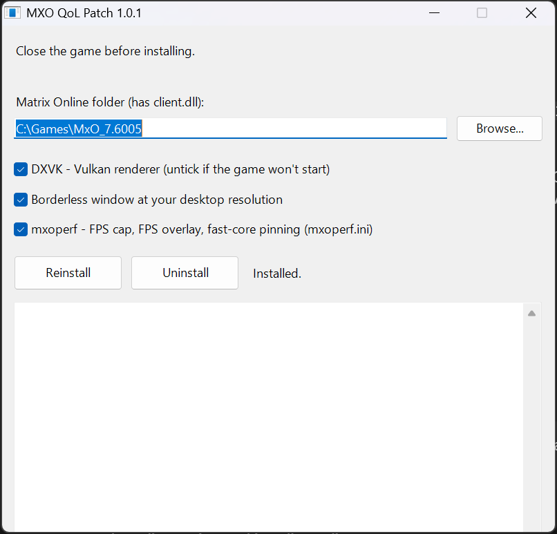

# MXO QoL Patch

Quality-of-life fixes for **The Matrix Online 7.6005** (e.g. on [Rejacked](https://mxo-rejacked.com)):

- **Borderless window** at your desktop resolution
- **DXVK** (Vulkan) renderer, smoother on modern GPUs
- **mxoperf**: FPS cap (focused and background), FPS overlay (Ctrl+Alt+O), frame-time capture (Ctrl+Alt+P), render thread pinned to the fast cores (Intel hybrid / AMD X3D)
- **Hardware vertex processing**: the game no longer switches to software vertex processing
- **Alt-tab music fix**: music no longer stays silent after alt-tabbing out of fullscreen and back
- **UI scale** (optional, 1.5x or 2x): a readable interface at high resolutions such as 4K

## Install

1. Close the game.
2. Download `MXO_QoL_Patch.zip` from [Releases](../../releases), extract it, and run `MXO_QoL_Installer.exe` from the extracted folder (keep the `data` folder next to it). If your game folder needs administrator rights (e.g. it is under Program Files), the installer offers to restart itself as administrator.
3. Check the folder (found automatically from the Rejacked launcher if you use it), pick the options and press **Install**.
4. In the Rejacked launcher, leave **Window mode** on **"Game setting"**. Any other choice overrides the borderless setting.

Character select still switches to an 800x600 window, as in the stock game.

Run it again any time to change the options. **Uninstall** puts back the original `client.dll`, deletes every file it added, removes its lines from `autoexec.cfg` and puts back the `Windowed` value in the game's saved options.

**UI scale** is off by default. 2x suits 4K (3840x2160) and 1.5x suits 1440p to 1800p. The interface never lays out smaller than the 800x600 it was designed for, so on smaller screens the scale is lowered to fit, and the 800x600 character select stays at 1x. The installer shows the scale already installed, so **Reinstall** keeps it unless you change it.

Command line: `MXO_QoL_Installer.exe /install "C:\Games\MxO_7.6005" [/nodxvk] [/noborderless] [/noperf] [/nomusic] [/uiscale 1.5|2.0]` or `/uninstall "<folder>"`.

## VirusTotal

The 1.2.0 download, [`MXO_QoL_Patch.zip`](https://www.virustotal.com/gui/file/89c64b3744632435c8c8ee8b8676e70f5c8d13b9f17f5c4ee9f1ccf7c3f74970/detection), scans clean (0/67). The files inside it:

| File | SHA-256 | Result |
|---|---|---|
| `MXO_QoL_Installer.exe` | `1185a99b4691f4b8b6742376ddf3c881b9cd683a64b13e99ada527055795a2e6` | [1/70](https://www.virustotal.com/gui/file/1185a99b4691f4b8b6742376ddf3c881b9cd683a64b13e99ada527055795a2e6/detection) (SecureAge's generic "Malicious" flag on small unsigned programs) |
| `data\mxoperf.dll` | `50b57b003a1b6d9fc0c87ee1320cf1db3097035c1d867f9b0311e2c1c5027be3` | [0/71](https://www.virustotal.com/gui/file/50b57b003a1b6d9fc0c87ee1320cf1db3097035c1d867f9b0311e2c1c5027be3/detection) |
| `data\dxv9.dll` (DXVK) | `265888c31ca78dffa290c39cb7e50bfb02762590e41927906e46fb32f01497fa` | [0/71](https://www.virustotal.com/gui/file/265888c31ca78dffa290c39cb7e50bfb02762590e41927906e46fb32f01497fa/detection) |

The installer is built from `src\Installer.cs` in this repo, so you can read what it does or build it yourself with `build.cmd`.

## What it changes

| File | Change |
|---|---|
| `client.dll` | Backed up to `QoL_backup\client.dll`, then a few small code changes (see below). The installer checks every original byte first and changes nothing if your `client.dll` is a different build. |
| `r3dx.dll` | Made from **your own** `r3d9.dll` with its `d3d9.dll` import renamed to `dxv9.dll`, so the game can load DXVK from its folder. If DXVK is off it is an unmodified copy. |
| `dxv9.dll`, `dxvk.conf`, `DXVK_LICENSE.txt` | DXVK 3.1.1 (32-bit `d3d9.dll`). `dxvk.conf` also keeps DXVK's memory use down, because the game only has 2 GB of address space. Only when DXVK is on. |
| `mxoperf.dll`, `mxoperf.ini` | Only when mxoperf is on. Your existing `mxoperf.ini` is kept. |
| `autoexec.cfg` | A marked block with `Windowed = 2` and `ScreenWidth`/`ScreenHeight` set to your desktop size. |
| `%AppData%\The Matrix Online\options.cfg` | The game saves its options here and loads them after `autoexec.cfg`, so a saved `Windowed = 0` (e.g. from when the launcher forced fullscreen) would override borderless. With borderless on, that line is set to `Windowed = 2`; the old value is put back when borderless is turned off or on uninstall. |

The `client.dll` changes:

- **Borderless:** `Windowed = 2` means borderless. The window gets the `WS_POPUP` style, isn't shrunk to fit inside the desktop, and the in-game Windowed checkbox doesn't reset it to 1.
- **Renderer:** loads `r3dx.dll` instead of `r3d9.dll`.
- **mxoperf hook:** loads `mxoperf.dll` if it's there and calls it once per frame before Present.
- **Hardware vertex processing:** `SetSoftwareVertexProcessing` is always `FALSE`.
- **Music fix:** coming back from a minimised fullscreen window ran the music pause twice, and the second run saved the already-zero volume over the real one. The pause function (48 bytes, found by byte pattern) now only saves the volume when it is not zero.
- **Relocations:** the game DLL loads at a different address each time, so the 17 address fix-ups the new code needs are added to its relocation table and the 3 under the overwritten instructions are disabled.
- **UI scale** (only when chosen): the interface lays out at screen size / scale and its screen-space drawing is multiplied back up, while the interface draws. Lists clip through the Direct3D viewport, so that is scaled too. Mouse events and the cursor go to the interface in its own smaller pixels. World picking under the cursor and the projection that places name tags over characters are converted between the two. The scale is `max(1, min(chosen, width/800, height/600))`, worked out whenever the interface is resized. About 160 call sites are redirected to about 850 bytes of new code in unused padding, and 24 relocations are added. It is applied after the patch above and taken off before it on reinstall.

## Building

`build.cmd` compiles `MXO_QoL_Installer.exe` with the C# compiler that ships with Windows (.NET Framework 4), puts it in `dist\MXO_QoL_Patch\` next to a copy of `data\`, and zips that folder to `dist\MXO_QoL_Patch.zip`. Nothing else is needed.

`data\client_qol.patch` is a list of `offset original-bytes new-bytes` lines. It is generated by `tools\Build.java`, which also rebuilds the relocations. `tools\Check.java` checks that every relocation in a patched `client.dll` points inside the image. Run them with `java tools\Build.java <source-patch> <client.dll> <out.dll> <site list> <out.patch>`.

`data\client_ui1.5.patch` and `data\client_ui2.0.patch` (same format) are generated by `tools\UiScale.java` from a `client.dll` with `client_qol.patch` applied: `java tools\UiScale.java <client.dll> <scale> <out.dll> <out.patch>`. The addresses it patches are listed and explained in the tool.

